<a href="https://rythme.world"></a>

I’m Rythme. I write contracts, build products around them, and work with the developers using them. Co-founder of **[Web3Spell Labs](https://labs.web3spell.fun)**. Mostly DeFi, private payments, and agent infrastructure.

<picture>
<source media="(max-width: 600px)" srcset="./assets/v2/section-1-mobile.svg" />
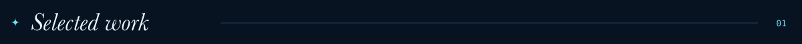
</picture>

<table>
<tr>
<td width="50%" valign="top">
<a href="https://github.com/GPU402/gpu402">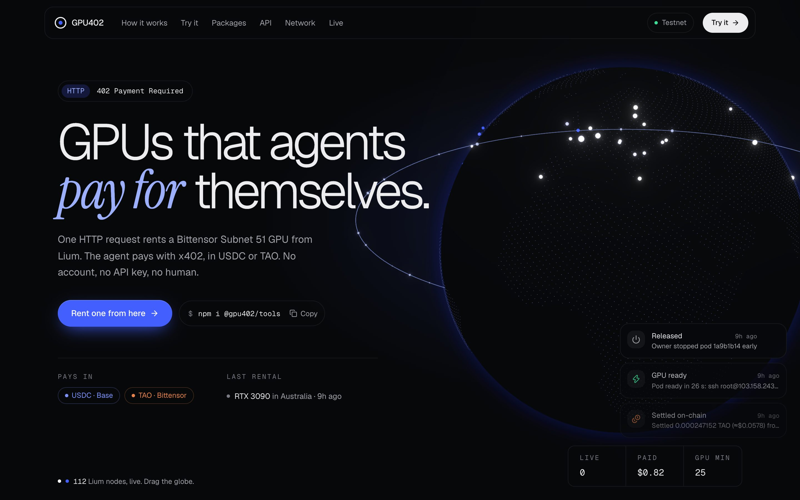</a>
<h3>GPUx402</h3>

TypeScript SDK + x402 gateway for Lium GPUs. Rent, run over SSH, and cap spending.

<a href="https://www.npmjs.com/package/gpu402"><b>npm: gpu402</b></a> · <a href="https://docs.lium.io/developers#community-clients"><b>Listed in Lium docs ↗</b></a>

<a href="https://github.com/GPU402/gpu402">Source ↗</a>

</td>
<td width="50%" valign="top">
<a href="https://github.com/Web3spell/chainpot">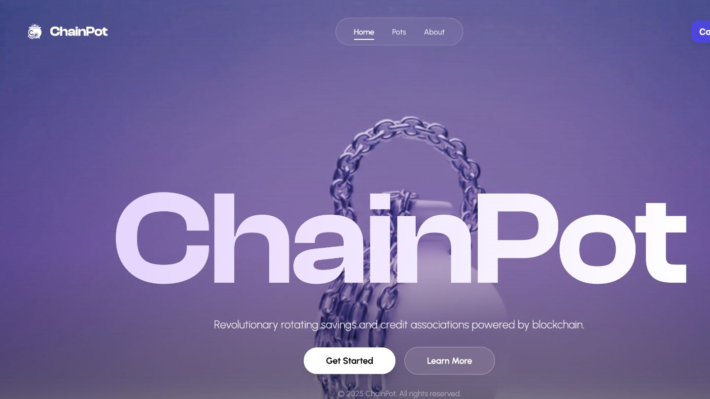</a>
<h3>ChainPot</h3>

Rotating savings circles on Base with Compound III yield. Backed by a <b>Compound grant</b>.

<a href="https://github.com/Web3spell/chainpot">Source ↗</a> · <a href="https://labs.web3spell.fun/work/chainpot">Case study ↗</a>

</td>
</tr>
<tr>
<td width="50%" valign="top">
<a href="https://github.com/MeetCivitas/Civitas-Sol">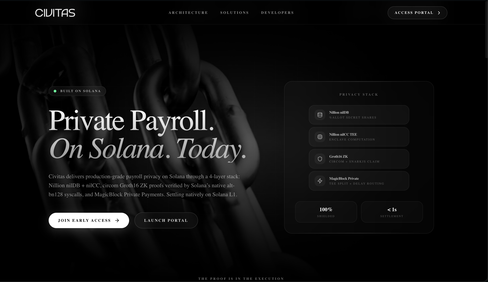</a>
<h3>Civitas</h3>

Private payroll on Solana devnet. Groth16 salary vouchers, Nillion compute, MagicBlock settlement.

<a href="https://github.com/MeetCivitas/Civitas-Sol">Source ↗</a> · <a href="https://labs.web3spell.fun/work/civitas">Case study ↗</a>

</td>
<td width="50%" valign="top">
<a href="https://github.com/rythmern02/aquaprime">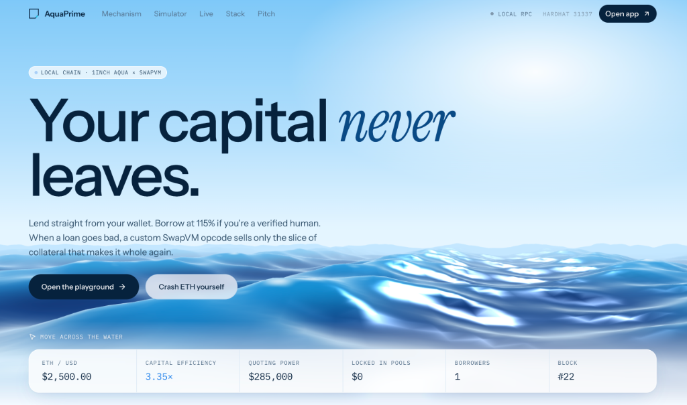</a>
<h3>AquaPrime</h3>

Credit-market prototype on 1inch Aqua + SwapVM. Wallet-held lender capital and exact-size liquidations.

<a href="https://github.com/rythmern02/aquaprime">Source ↗</a> · <a href="https://aquaprime-three.vercel.app">Demo ↗</a>

</td>
</tr>
<tr>
<td colspan="2" valign="top">
<a href="https://zhifi.vercel.app">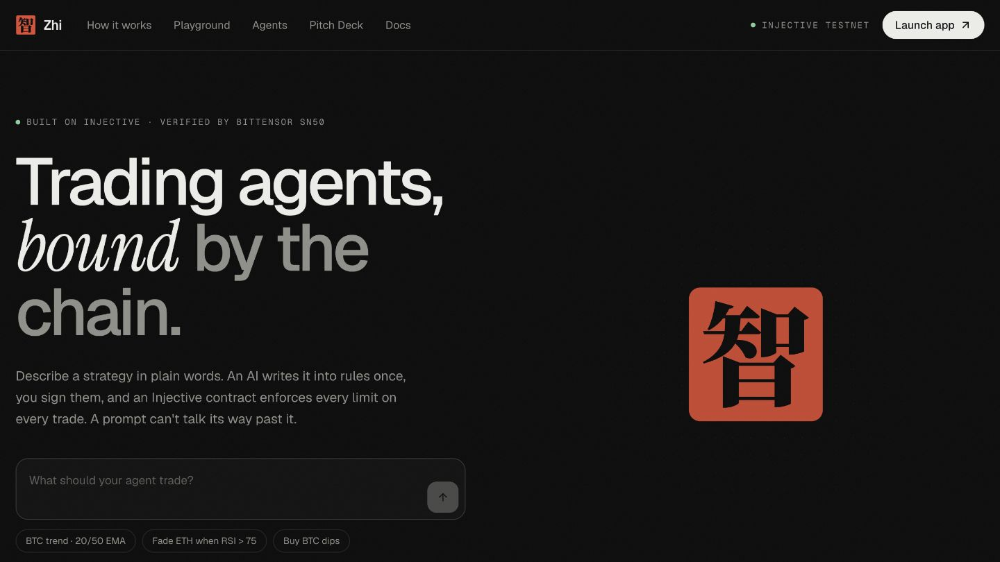</a>
<h3>Zhi 智</h3>

AI trading strategies with onchain risk limits. Signed rules, a Rust execution harness, and Bittensor SN50 checks on Injective testnet.

<a href="https://zhifi.vercel.app"><b>Live app ↗</b></a> · <a href="https://github.com/zhi-finance/zhi">Source ↗</a> · <a href="https://github.com/zhi-finance">zhi-finance ↗</a>

</td>
</tr>
</table>

Also building: **[Divergence Router](https://github.com/rythmern02/Divergence-Router)** · **[Rootstock Paymaster Kit](https://github.com/rythmern02/Rootstock-Paymaster-Kit)** · **[DreamDEX SDK feedback](https://github.com/rythmern02/dreamdex-perps-feedback)**

<picture>
<source media="(max-width: 600px)" srcset="./assets/v2/section-2-mobile.svg" />
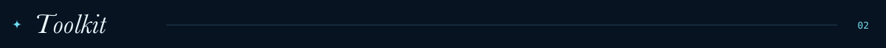
</picture>

Foundry · Anchor · Circom / Groth16 · ERC-4337 · x402

<picture>
<source media="(max-width: 600px)" srcset="./assets/v2/section-3-mobile.svg" />
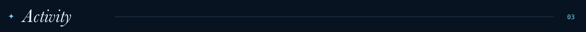
</picture>

<a href="https://github.com/rythmern02?tab=overview">
<picture>
<source media="(max-width: 600px)" srcset="./assets/v2/activity-mobile.svg" />
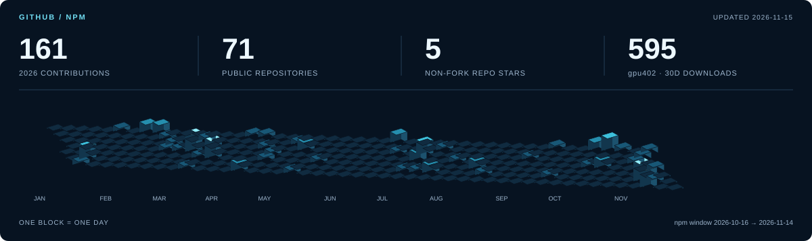
</picture>
</a>

<picture>
<source media="(max-width: 600px)" srcset="./assets/v2/section-4-mobile.svg" />
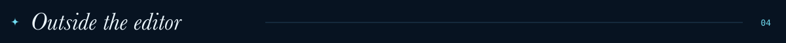
</picture>

I run developer programs through **[Web3Spell](https://labs.web3spell.fun)** and host **[SpellCast](https://labs.web3spell.fun/spellcast)** with protocol founders and DevRel leads.

**Protocol engineering / DevRel. Singapore or remote.** [Let’s talk ↗](mailto:rythmenagrani@gmail.com)
